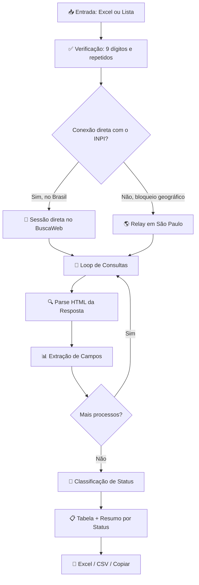
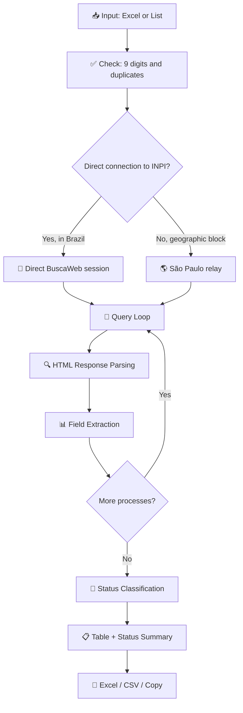

<h1 align="center">
  <br>🔎 INPédia — Consulta Inteligente de Marcas INPI</h1>

<div align="center">

<!-- Demo GIF -->
<!--  -->

[](https://www.python.org/)
[](https://streamlit.io/)
[](https://github.com/GabrielaSchmitt/INPedia/releases)
[](./LICENSE)

</div>

---

<a id="pt-readme"></a>

## 🌐 [English](#en-readme) | Português

### 🚀 Acesse o aplicativo: **[inpedia.streamlit.app](https://inpedia.streamlit.app/)**

> 💡 **Recomendado:** rodar a INPédia no seu computador (veja o [Guia de Instalação](#-guia-de-instalação)). Assim a consulta vai direto ao INPI, sem intermediários, e fica mais rápida.

---

## 📋 Sobre o Projeto

**INPédia** é uma ferramenta de automação desenvolvida para consultar processos de marcas no **INPI (Instituto Nacional da Propriedade Industrial)** de forma rápida, organizada e em lote.

A aplicação foi construída com **Python** e **Streamlit**, oferecendo uma interface web moderna e intuitiva que substitui o processo manual de verificação individual de cada protocolo de marca na plataforma do governo.

### 🏛️ O que é o INPI?

O **INPI (Instituto Nacional da Propriedade Industrial)** é a autarquia federal brasileira responsável pelo registro e concessão de marcas, patentes, desenhos industriais, transferências de tecnologia e indicações geográficas. A consulta pública de marcas é feita através do sistema **BuscaWeb** em [busca.inpi.gov.br](https://busca.inpi.gov.br).

### 🎯 Propósito

Automatizar a verificação de estado de protocolos de marcas registradas no INPI, eliminando a necessidade de consultas manuais individuais. Ideal para escritórios de propriedade intelectual, departamentos jurídicos e empresas que gerenciam múltiplas marcas.

---

## ✨ Funcionalidades Principais

| Funcionalidade | Descrição |
|---------------|-----------|
| 📤 **Upload de Excel** | Interface drag-and-drop para importar planilhas com números de processos |
| 📋 **Colar Lista** | Cole uma lista copiada do Excel e clique direto em consultar |
| ✅ **Verificação das Entradas** | Antes de consultar, confere se cada número tem 9 dígitos e identifica repetidos; nada é descartado em silêncio |
| 🔍 **Consulta em Lote** | Processamento automático de múltiplos processos com barra de progresso |
| 🚦 **Status com Nome** | Cada processo recebe ícone e categoria (ex.: ®️ Registro em vigor), com resumo por categoria |
| 📊 **Exportação Excel/CSV** | Download dos resultados em formatos prontos para uso |
| 📋 **Copiar Tabela** | Copia todos os resultados para colar direto em uma planilha ou e-mail, sem baixar arquivo |
| 💬 **Erros Explicados** | Cada falha mostra a causa e o diagnóstico da conexão |
| 🌎 **Funciona fora do Brasil** | Na versão publicada, usa um relay em São Paulo para contornar o bloqueio geográfico do INPI |
| ⚡ **Intervalo entre processos** | Opções de 1 a 5 s, com estimativa do tempo total. Com 1 s ou mais, o ritmo fica em no máximo 120 consultas por minuto, o limite de bloqueio informado pelo INPI na RPI nº 2728 (18/04/2023) |

---

## 🏗️ Arquitetura da Solução



Entradas inválidas ou repetidas **não são consultadas**, mas aparecem na tabela final, na mesma linha da entrada, com o motivo na coluna `observacao`.

---

## 📊 Dados da Tabela de Resultados

| Campo | Descrição |
|-------|-----------|
| **linha** | Posição na entrada (linha do Excel ou da lista colada) |
| **entrada** | Valor exatamente como foi digitado |
| **numero_processo** | Número do processo de marca, já normalizado |
| **observacao** | Motivo quando a linha não foi consultada ou a consulta falhou |
| **marca** | Nome da marca registrada |
| **situacao** | Situação atual do processo no INPI |
| **status** | 🚦 Categoria da situação (ícone + nome) |
| **apresentacao** | Tipo de apresentação da marca |
| **natureza** | Natureza da marca |
| **titular** | Titular da marca |
| **procurador** | Procurador responsável |
| **data_deposito** | Data de depósito do pedido |
| **data_concessao** | Data de concessão (se aplicável) |
| **data_vigencia** | Data de vigência do registro |
| **prioridade** | Prioridade unionista, quando houver |
| **classe_nice** | Classificação Internacional de Nice |
| **especificacao** | Descrição dos produtos/serviços |
| **ultimo_despacho_rpi / _data / _titulo** | Número e data da RPI e título do último despacho |

### 🚦 Categorias de Status

| Status | Quando aparece |
|--------|----------------|
| ✅ **Em andamento** | Aguardando exame ou deferido |
| ®️ **Registro em vigor** | Registro de marca em vigor |
| ❌ **Encerrado** | Indeferido, extinto, arquivado ou nulidade |
| 🟡 **Atenção** | Oposição ou sobrestado |
| ⚪ **Outros** | Qualquer outra situação |
| ⚠️ **Erro** | Erro de preenchimento ou falha na consulta (veja `observacao`) |
| 🔁 **Repetido** | Número já consultado em uma linha anterior |

---

## 📁 Estrutura do Projeto

```
INPedia/
│
├── 📄 app.py                      # Interface Streamlit (UI/UX)
├── ✅ inpi_entrada.py             # Verificação das entradas (tipagem e repetidos)
├── 🔧 inpi_engine.py              # Motor de consulta (conexão direta ou relay)
├── 🔍 inpi_parser.py              # Parser HTML dos resultados
├── 📋 requirements.txt            # Dependências Python
├── 📖 README.md                   # Documentação
│
├── 📂 .streamlit/
│   ├── ⚙️ config.toml             # Tema e configurações Streamlit
│   └── 🔑 secrets.toml.example    # Modelo de configuração do relay
│
└── 📂 supabase/functions/inpi-relay/
    └── 🌎 index.ts                # Relay em São Paulo (Edge Function)
```

---

## 🚀 Guia de Instalação

Este é o **modo de uso recomendado**: a consulta sai do seu computador direto para o INPI.

### Pré-requisitos

- Python 3.10 ou superior
- pip (gerenciador de pacotes)
- Conexão com a internet **no Brasil** (o INPI recusa conexões de fora do país)

### 1️⃣ Clone o Repositório

```bash
git clone https://github.com/GabrielaSchmitt/INPedia.git
cd INPedia
```

### 2️⃣ Crie o Ambiente Virtual

**Windows (PowerShell):**
```bash
python -m venv venv
.\venv\Scripts\Activate.ps1
```

**Linux/Mac:**
```bash
python -m venv venv
source venv/bin/activate
```

### 3️⃣ Instale as Dependências

```bash
pip install -r requirements.txt
```

### 4️⃣ Execute a Aplicação

```bash
streamlit run app.py
```

A aplicação será aberta automaticamente no navegador em `http://localhost:8501`

---

## 🌎 Hospedagem fora do Brasil (relay em São Paulo)

O INPI recusa conexões vindas de IPs fora do Brasil (bloqueio de rede, antes de qualquer requisição HTTP). Rodando no Brasil, o app consulta o INPI diretamente. No Streamlit Community Cloud, que roda nos EUA, a conexão direta é recusada e o app passa a usar um **relay**: uma Edge Function do Supabase executada em São Paulo (`sa-east-1`), que faz a consulta e devolve a página do processo para o app analisar.

- Código da função: [`supabase/functions/inpi-relay/index.ts`](supabase/functions/inpi-relay/index.ts). Aceita só números de processo e só acessa `busca.inpi.gov.br`.
- O intervalo entre consultas é mantido, e nenhum mecanismo de autenticação é contornado: a consulta parte do Brasil, como a de qualquer usuário no país.
- Configuração no Streamlit Cloud (**Settings → Secrets**), conforme [`.streamlit/secrets.toml.example`](.streamlit/secrets.toml.example):

```toml
INPEDIA_RELAY_URL = "https://<projeto>.supabase.co/functions/v1/inpi-relay"
INPEDIA_RELAY_KEY = "<chave anon do projeto Supabase>"
```

O Supabase é usado apenas como relay: uma função, sem banco de dados.

> No plano gratuito, o Supabase pode pausar projetos com baixa atividade e avisa o dono do projeto por e-mail antes disso. Se o app indicar "relay pausado", reative o projeto no painel do Supabase.

---

## 📖 Como Usar

### Passo a Passo

1. **Importe seus processos**
   - 📄 Faça upload de um arquivo Excel (.xlsx) e escolha a coluna dos números
   - 📋 Ou cole uma lista de processos na caixa de texto, um por linha
   - ✅ Números com pontos, hífens ou espaços (ex.: `932.062.598`) são aceitos

2. **Configure e consulte**
   - ⚙️ Escolha o intervalo entre processos (padrão: 1 s) e confira o tempo estimado
   - 🔘 Clique em **"CONSULTAR PROCESSOS"** (pode clicar logo depois de colar)
   - 📊 Acompanhe o progresso pela barra de carregamento

3. **Use os resultados**
   - 🚦 Veja o resumo por status logo acima da tabela
   - 📥 Baixe em **Excel (.xlsx)** ou **CSV**, ou clique em **"Copiar tabela"**
   - 💬 Linhas com ⚠️ ou 🔁 trazem o motivo na coluna `observacao`
   - 🔄 Clique em **"Realizar nova consulta"** para recomeçar

### ❓ Em caso de erro

1. Leia a mensagem em vermelho e o **Diagnóstico da conexão**: eles dizem a causa.
2. Se o INPI estiver fora do ar ou lento, tente de novo em alguns minutos.
3. Verifique se há uma **versão mais recente** em [Releases](https://github.com/GabrielaSchmitt/INPedia/releases) e atualize sua cópia (`git pull`).

---

## 🏷️ Versões

| Versão | Principais mudanças |
|--------|---------------------|
| **1.1** | Relay em São Paulo para hospedagem fora do Brasil; verificação das entradas (9 dígitos e repetidos); mensagens de erro com diagnóstico; status com nome e resumo por categoria; botão "Copiar tabela"; correção da leitura da classe de Nice e da especificação; validação do certificado do INPI |
| **1.0** | Consulta em lote, extração dos campos, semáforo de status e exportação Excel/CSV |

---

## 🤝 Suporte

Para dúvidas, problemas ou sugestões:

📧 **Contato:** [GitHub Issues](https://github.com/GabrielaSchmitt/INPedia/issues)

---

## 📄 Licença

Código aberto sob a [Licença MIT](./LICENSE): você pode usar, copiar, modificar e distribuir o código, inclusive para fins comerciais, desde que mantenha o aviso de direitos autorais e a licença.

Os dados consultados são públicos e provenientes da [Pesquisa Pública do INPI](https://busca.inpi.gov.br), que não é a fonte oficial: decisões sobre processos devem ser confirmadas na Revista da Propriedade Industrial (RPI). A ferramenta é fornecida "no estado em que se encontra", sem garantias.

---

<div align="center">

**INPédia** 🔎 © 2026 — Gabriela Schmitt

</div>

---
---

<a id="en-readme"></a>

## 🌐 English | [Português](#pt-readme)

### 🚀 Access the application: **[inpedia.streamlit.app](https://inpedia.streamlit.app/)**

> 💡 **Recommended:** run INPédia on your own computer (see the [Installation Guide](#-installation-guide)). Lookups then go straight to INPI, with no intermediary, and run faster.

---

## 📋 About the Project

**INPédia** is an automation tool developed to query trademark processes at **INPI (Brazilian National Institute of Industrial Property)** quickly, organized, and in batch.

Built with **Python** and **Streamlit**, the application offers a modern and intuitive web interface that replaces the manual process of individually checking each trademark protocol on the government platform.

### 🏛️ What is INPI?

**INPI (Instituto Nacional da Propriedade Industrial)** is the Brazilian federal agency responsible for the registration and granting of trademarks, patents, industrial designs, technology transfers, and geographical indications. Public trademark searches are done through the **BuscaWeb** system at [busca.inpi.gov.br](https://busca.inpi.gov.br).

### 🎯 Purpose

Automate the verification of trademark protocol statuses registered at INPI, eliminating the need for individual manual queries. Ideal for intellectual property offices, legal departments, and companies managing multiple trademarks.

---

## ✨ Key Features

| Feature | Description |
|---------|-------------|
| 📤 **Excel Upload** | Drag-and-drop interface for importing spreadsheets with process numbers |
| 📋 **Paste List** | Paste a list copied from Excel and click query right away |
| ✅ **Input Check** | Before querying, checks that each number has 9 digits and flags duplicates; nothing is silently dropped |
| 🔍 **Batch Query** | Automatic processing of multiple processes with progress bar |
| 🚦 **Named Status** | Each process gets an icon and a category (e.g., ®️ Registro em vigor), with a summary per category |
| 📊 **Excel/CSV Export** | Download results in ready-to-use formats |
| 📋 **Copy Table** | Copies all results to paste straight into a spreadsheet or email, with no download |
| 💬 **Explained Errors** | Each failure shows its cause and a connection diagnosis |
| 🌎 **Works outside Brazil** | The hosted version uses a São Paulo relay to get around INPI's geographic block |
| ⚡ **Interval between lookups** | Options from 1 to 5 s, with an estimate of the total time. At 1 s or more, the rate stays at or below 120 queries per minute, the blocking threshold stated by INPI in RPI no. 2728 (2023-04-18) |

---

## 🏗️ Solution Architecture



Invalid or duplicate entries are **not queried**, but they appear in the final table, on the same row as the input, with the reason in the `observacao` column.

---

## 📊 Results Table

| Field | Description |
|-------|-------------|
| **linha** | Position in the input (Excel row or pasted line) |
| **entrada** | Value exactly as typed |
| **numero_processo** | Trademark process number, normalized |
| **observacao** | Reason when the row was not queried or the query failed |
| **marca** | Registered trademark name |
| **situacao** | Current process status at INPI |
| **status** | 🚦 Status category (icon + name) |
| **apresentacao** | Trademark presentation type |
| **natureza** | Trademark nature |
| **titular** | Trademark holder |
| **procurador** | Responsible attorney |
| **data_deposito** | Application filing date |
| **data_concessao** | Grant date (if applicable) |
| **data_vigencia** | Registration validity date |
| **prioridade** | Paris Convention (unionist) priority, if any |
| **classe_nice** | International Nice Classification |
| **especificacao** | Products/services description |
| **ultimo_despacho_rpi / _data / _titulo** | RPI number and date, and title of the latest dispatch |

### 🚦 Status Categories

| Status | Meaning |
|--------|---------|
| ✅ **Em andamento** | Awaiting examination or granted |
| ®️ **Registro em vigor** | Active trademark registration |
| ❌ **Encerrado** | Rejected, extinct, archived, or annulment |
| 🟡 **Atenção** | Opposition or stayed |
| ⚪ **Outros** | Any other status |
| ⚠️ **Erro** | Input error or failed query (see `observacao`) |
| 🔁 **Repetido** | Number already queried on an earlier row |

---

## 📁 Project Structure

```
INPedia/
│
├── 📄 app.py                      # Streamlit interface (UI/UX)
├── ✅ inpi_entrada.py             # Input check (format and duplicates)
├── 🔧 inpi_engine.py              # Query engine (direct connection or relay)
├── 🔍 inpi_parser.py              # HTML results parser
├── 📋 requirements.txt            # Python dependencies
├── 📖 README.md                   # Documentation
│
├── 📂 .streamlit/
│   ├── ⚙️ config.toml             # Streamlit theme and settings
│   └── 🔑 secrets.toml.example    # Relay configuration template
│
└── 📂 supabase/functions/inpi-relay/
    └── 🌎 index.ts                # São Paulo relay (Edge Function)
```

---

## 🚀 Installation Guide

This is the **recommended way to use INPédia**: lookups go from your computer straight to INPI.

### Prerequisites

- Python 3.10 or higher
- pip (package manager)
- Internet connection **in Brazil** (INPI refuses connections from outside the country)

### 1️⃣ Clone the Repository

```bash
git clone https://github.com/GabrielaSchmitt/INPedia.git
cd INPedia
```

### 2️⃣ Create Virtual Environment

**Windows (PowerShell):**
```bash
python -m venv venv
.\venv\Scripts\Activate.ps1
```

**Linux/Mac:**
```bash
python -m venv venv
source venv/bin/activate
```

### 3️⃣ Install Dependencies

```bash
pip install -r requirements.txt
```

### 4️⃣ Run the Application

```bash
streamlit run app.py
```

The application will automatically open in your browser at `http://localhost:8501`

---

## 🌎 Hosting outside Brazil (São Paulo relay)

INPI refuses connections from IP addresses outside Brazil (a network-level block, before any HTTP request). When running in Brazil, the app queries INPI directly. On Streamlit Community Cloud, which runs in the US, the direct connection is refused and the app falls back to a **relay**: a Supabase Edge Function executed in São Paulo (`sa-east-1`) that performs the lookup and returns the application page for the app to parse.

- Function source: [`supabase/functions/inpi-relay/index.ts`](supabase/functions/inpi-relay/index.ts). It only accepts application numbers and only reaches `busca.inpi.gov.br`.
- The interval between queries is kept, and no authentication mechanism is bypassed: the lookup comes from Brazil, like any user in the country.
- Streamlit Cloud configuration (**Settings → Secrets**), as in [`.streamlit/secrets.toml.example`](.streamlit/secrets.toml.example):

```toml
INPEDIA_RELAY_URL = "https://<project>.supabase.co/functions/v1/inpi-relay"
INPEDIA_RELAY_KEY = "<Supabase project anon key>"
```

Supabase is used only as a relay: one function, no database.

> On the free plan, Supabase may pause projects with low activity, and it emails the project owner before doing so. If the app reports "relay paused", resume the project in the Supabase dashboard.

---

## 📖 How to Use

### Step by Step

1. **Import your processes**
   - 📄 Upload an Excel file (.xlsx) and choose the column with the numbers
   - 📋 Or paste a list of processes into the text box, one per line
   - ✅ Numbers with dots, hyphens, or spaces (e.g., `932.062.598`) are accepted

2. **Configure and query**
   - ⚙️ Choose the interval between lookups (default: 1 s) and check the estimated time
   - 🔘 Click **"CONSULTAR PROCESSOS"** (you can click right after pasting)
   - 📊 Track progress via the loading bar

3. **Use the results**
   - 🚦 See the status summary right above the table
   - 📥 Download as **Excel (.xlsx)** or **CSV**, or click **"Copiar tabela"**
   - 💬 Rows marked ⚠️ or 🔁 show the reason in the `observacao` column
   - 🔄 Click **"Realizar nova consulta"** to start over

### ❓ If something goes wrong

1. Read the red message and the **connection diagnosis**: they state the cause.
2. If INPI is offline or slow, try again in a few minutes.
3. Check for a **newer version** under [Releases](https://github.com/GabrielaSchmitt/INPedia/releases) and update your copy (`git pull`).

---

## 🏷️ Versions

| Version | Main changes |
|---------|--------------|
| **1.1** | São Paulo relay for hosting outside Brazil; input check (9 digits and duplicates); error messages with diagnosis; named status and per-category summary; "Copiar tabela" button; fixed Nice class and specification parsing; INPI certificate validation |
| **1.0** | Batch lookup, field extraction, status semaphore, and Excel/CSV export |

---

## 🤝 Support

For questions, issues, or suggestions:

📧 **Contact:** [GitHub Issues](https://github.com/GabrielaSchmitt/INPedia/issues)

---

## 📄 License

Open source under the [MIT License](./LICENSE): you may use, copy, modify, and distribute the code, including for commercial purposes, as long as you keep the copyright notice and the license.

Queried data is public and comes from the [INPI Public Search](https://busca.inpi.gov.br), which is not the official source: decisions about applications should be confirmed in the Revista da Propriedade Industrial (RPI). The tool is provided "as is", without warranty.

---

<div align="center">

**INPédia** 🔎 © 2026 — Gabriela Schmitt

</div>
